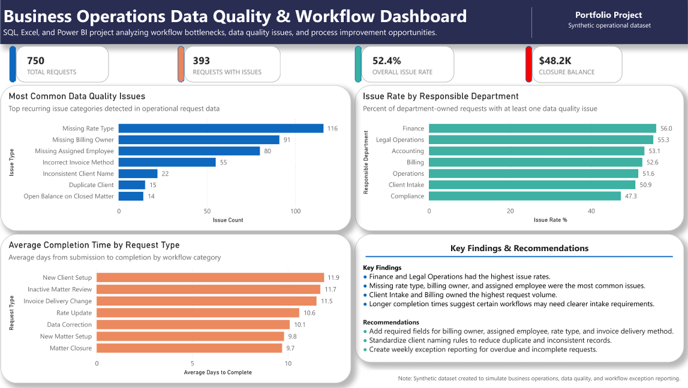
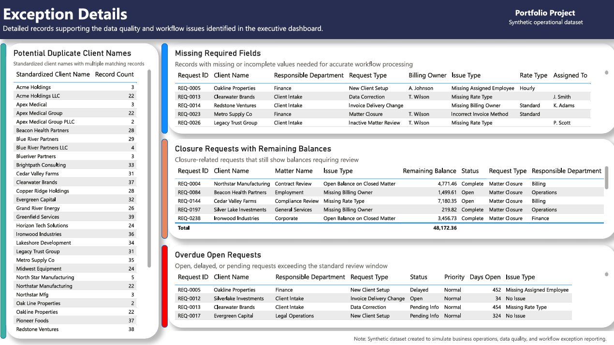

# Business operations data quality analysis

**SQL, SQLite, Excel and Power BI | Synthetic operational requests | Joshua Smith**

An operations reporting project that turns request records into a department overview and actionable exception lists. The analysis asks where data quality issues concentrate, which workflows take longer to finish, and which requests need follow-up before processing or closure.



[View the dashboard PDF](business-operations-dashboard.pdf) · [Explore the SQL](analysis.sql) · [Read the metric definitions](methodology.md) · [Inspect the Power BI model](power-bi-model.md)

## Business question

An internal operations team handles client setup, billing changes, matter closures and record maintenance. Incomplete fields, inconsistent names and aging requests can create extra review work. This project uses intentionally imperfect synthetic data to show how a shared reporting process can make those exceptions visible.

## Results at a glance

The dataset contains **750 requests submitted from January 1, 2025 through April 28, 2026**. Open-request aging uses a fixed **May 1, 2026** reference date.

| Measure | Verified result |
| --- | ---: |
| Requests carrying a source issue label | 393 of 750, or 52.4% |
| Requests with at least one blank required field | 394 |
| Open, pending or delayed requests older than 14 days | 219 |
| Matter closure requests with a positive balance | 14 |
| Balance associated with those closure requests | $48,172.36 |

- **Finance and Legal Operations had the highest labeled issue rates:** 56.0% and 55.3%, respectively. These percentages use each department's own request count as the denominator.
- **Client Intake and Billing carried the largest request volumes:** 159 and 152 requests, together accounting for 41.5% of the dataset.
- **The most frequent source issue labels were missing rate type (116), billing owner (91) and assigned employee (80).** These are source categories, rather than independently detected counts for each field.
- **Address Update had the longest average elapsed time in the full SQL output:** 12.0 days among requests with a completion date. The dashboard preview shows seven of ten request types; the [complete results](verified-results.md) include every type.

The $48,172.36 balance covers closure requests in several statuses, including open and cancelled. It is an exception-review amount, not a confirmed balance on completed closures or an estimate of savings.

## Approach

1. Start with an Excel source dataset and export one request per row to CSV.
2. Load the CSV into SQLite, preserve the raw fields and convert Excel serial dates into ISO dates in a cleaned table.
3. Create eight SQL views for department volume, labeled issue rates, issue categories, completion time and record-level exceptions.
4. Use the view outputs in Power BI for an executive dashboard and an exception details page.
5. Rebuild the SQL results from the included CSV and reconcile counts, dates and balances. Separate validation queries make the source-label and status assumptions explicit.



## Proposed operational actions

| Finding | Proposed response |
| --- | --- |
| Blank ownership, rate and delivery fields | Require the relevant fields at intake and route exceptions to an owner. |
| 219 requests exceed the review window | Review a weekly aging queue by department, request type and priority. |
| Closure requests retain positive balances | Add a balance review before confirming closure. |
| Client names vary across request records | Review candidate matches against a client master before changing records. |

These are recommendations from a portfolio simulation. No production implementation, measured time savings or employer impact is claimed.

## Reproduce the analysis

Requires Python 3.10 or later. The script uses only the Python standard library.

```bash
python validate.py
```

This creates a SQLite database, twelve query CSVs and a validation summary in `outputs/`. The script checks unique request IDs, date conversion and ordering, department and issue reconciliations, published exception counts, and an independent decimal calculation of the closure-request balance. To use DB Browser for SQLite, open `outputs/business_operations.db` after running it.

The rebuild reproduces the SQL analysis. The original Power BI presentation is included as screenshots and PDF. The [Power Query source](power-query.m) and [model relationships](power-bi-model.md) show how the SQL outputs feed the report. Set the documented `DataFolder` parameter to the generated CSV directory to use the query definitions. The original PBIX remains local because it embeds local source paths.

## Files and review notes

| Location | Contents |
| --- | --- |
| [`raw-requests.csv`](raw-requests.csv) | The original synthetic request export |
| [`data-dictionary.md`](data-dictionary.md) | Row meaning, fields, dates and categories |
| [`analysis.sql`](analysis.sql), [`schema.sql`](schema.sql), [`validation.sql`](validation.sql) | Import schema, original analysis and additional validation views |
| [`validate.py`](validate.py) | Rebuild and reconciliation script |
| [`power-query.m`](power-query.m) and [`power-bi-model.md`](power-bi-model.md) | Extracted Power Query source with portable paths, model relationships and column types |
| [`verified-results.md`](verified-results.md) | Complete department and completion-time results |
| [`methodology.md`](methodology.md) | Definitions, dashboard scope and limitations |

All organizations, people, client identifiers and financial amounts in the dataset are synthetic. The original project materials identify the dataset as created for portfolio practice; no confidential employer data was used. The original dashboard design and SQL views are preserved, with additional reproducibility and validation documentation in this repository.
